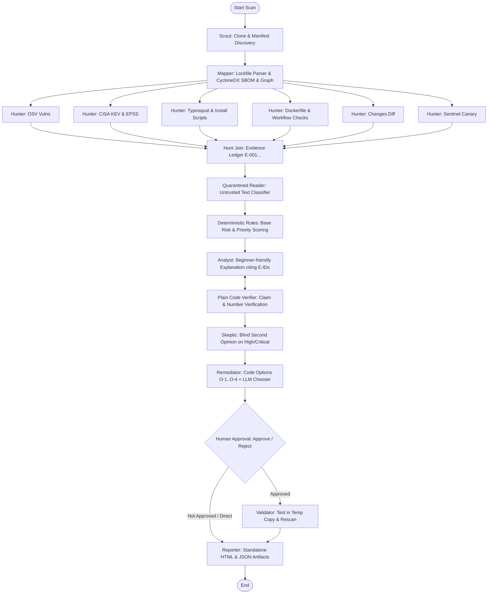

# Architecture Overview: Software Supply Chain Guardian

## System Flow

## Component Breakdown
| Component | Input | Output | Uses AI? | Why It Exists |
| :--- | :--- | :--- | :--- | :--- |
| **Orchestrator** | Target source & config | Executed DAG & State | No (LangGraph) | Deterministic sequencing, timeouts, and checkpointing |
| **Scout** | GitHub URL or local path | Safe cloned repo & file list | No | Sandbox boundary: verifies limits (300MB, 60s) |
| **Mapper** | package-lock.json | CycloneDX SBOM & NetworkX graph | No | Component discovery & shortest dependency path |
| **Hunter** | Components & source | Vulnerability & metadata parts | No | Fast deterministic queries (OSV, KEV, EPSS, static) |
| **Reader** | Raw scripts & RUN lines | Strict boolean flags | Yes (Quarantined) | Isolated text classifier; cannot touch facts or tools |
| **Rules** | Ledger & changes | Ranked findings (F-001...) | No | Transparent 0-100 priority score & confidence calculation |
| **Analyst** | Top 10 findings & evidence | Plain English explanations | Yes | Explains issues citing only ledger IDs [E-xxx] |
| **Verifier** | AI explanations & ledger | Validated text / Reject error | No | Zero-hallucination guarantee: checks all numbers & IDs |
| **Skeptic** | Top 5 High/Crit findings | Blind second opinion | Yes (Bigger model) | Adversarial sanity check; flags status as needs-review |
| **Remediator** | Vulnerable components | Options O-1..O-4 + AI choice | Hybrid | Code generates exact safe options; AI picks best fit |
| **Validator** | Approved option & repo | Before/after metrics & patch | No | Applies fix to temp copy, tests lockfile, rescans |
| **Reporter** | Run artifacts | Standalone report.html & JSON | No | Offline readable report with autoescape security |
| **Ledger** | Facts from eyes | Immutable facts (E-001...) | No | Single source of truth that LLMs cannot fabricate |
| **Cache** | Feed responses & LLM calls | Cached disk responses | No | Instant offline replays & deterministic evaluation |
| **Trace** | Agent runtime events | trace.jsonl & status | No | Complete observability for cost, latency, & tokens |
| **Streamlit UI** | User interactions | 7 interactive dashboards | No | Clear separation of verified facts from AI suggestions |
| **Eval** | Planted fixtures | 6-metric scorecard | No | Continuous verification of recall & hallucination rate |

## Roadmap (Out of Scope for v4)
- Ecosystems: PyPI, Maven, Go, Cargo
- Policy-as-Code engines (OPA / Rego)
- Continuous webhook/repo watching
- Package maintainer reputation & age signals
